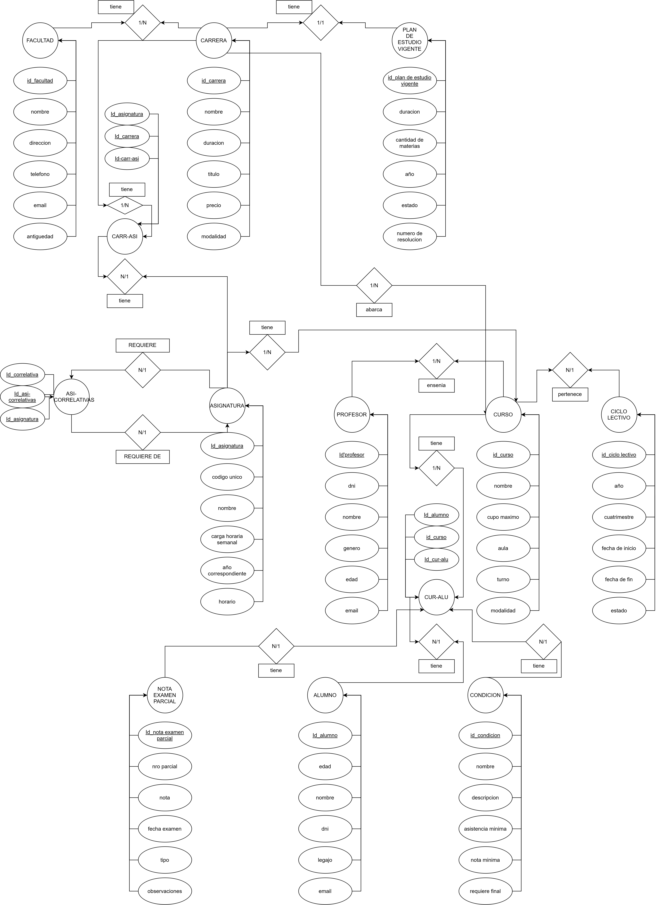

# BASE DE DATOS — Ejercicio 5: Sistema de Control Académico y Gestión Curricular

Trabajo práctico de Base de Datos (Universidad Champagnat). Este repositorio contiene todo el desarrollo del ejercicio 5: modelo entidad-relación, modelo relacional y normalización (1FN, 2FN y 3FN).

## Consigna


#### Contexto


Una facultad universitaria necesita rediseñar su sistema de gestión académica para administrar eficientemente las carreras, los planes de estudio, la matriculación de alumnos en asignaturas y el registro de calificaciones parciales y finales.


#### Consigna


Modelar el sistema académico cumpliendo estrictamente con las siguientes especificaciones:

La facultad imparte distintas carreras (ej. Ingeniería en Sistemas, Licenciatura en Administración), identificadas por un código y un nombre. Cada carrera posee un plan de estudio vigente.

Una carrera se compone de un conjunto de asignaturas (materias). Cada asignatura tiene un código único, nombre, carga horaria semanal y un año correspondiente dentro de la currícula.

Una asignatura puede tener asignadas correlativas (requisitos previos de aprobación). Es decir, para cursar una materia, el alumno puede tener la obligación de haber aprobado previamente otras materias del plan de estudio.

Las asignaturas se dictan en comisiones (o cursos) específicos para cada ciclo lectivo (por ejemplo, Comisón A del primer cuatrimestre de 2026), teniendo un cupo máximo de alumnos y un profesor responsable asignado.

Los alumnos se matriculan en las comisiones de las asignaturas. En dicha matriculación (inscripción a cursada) se debe registrar la condición del alumno (Regular, Libre, Promocionado) y las notas obtenidas en los exámenes parciales rendidos durante el cursado.


#### Desarrollo requerido


Diseñar la estructura de Carrera, Plan de Estudio y Asignatura, estableciendo sus cardinalidades correspondientes.

Modelar la autorrelación recursiva en la entidad Asignatura para representar las Correlatividades (requisitos de aprobación).

Definir las entidades Profesor, Comisión y Ciclo Lectivo, asociándolas adecuadamente con la asignatura.

Estructurar la relación N:M entre Alumno y Comisión (inscripción), incorporando las entidades o atributos necesarios para almacenar las instancias de evaluaciones parciales.

## Estructura del repositorio

```
BASE_DE_DATOS_Ejercicio_5/
├── README.md
├── modelo-er/
│   ├── ejercicio_5.drawio        # diagrama editable (draw.io)
│   └── ejercicio_5.png           # exportación del diagrama
├── modelo-relacional/
│   ├── ejercicio_5_MR.xlsx               # modelo relacional
│   └── ejercicio_5_con_datos.xlsx        # modelo relacional con datos de ejemplo
└── normalizacion/
    ├── ejercicio_5_1FN.xlsx
    ├── ejercicio_5_2FN.xlsx
    └── ejercicio_5_3FN.xlsx
```

## Modelo entidad-relación



Archivo editable: [`modelo-er/ejercicio_5.drawio`](modelo-er/ejercicio_5.drawio).

## Modelo relacional

Tablas del modelo relacional original, antes de normalizar (`(PK)` clave primaria, `(FK)` clave foránea, `(UNIQUE)` valor único):

- **FACULTAD**: `id_facultad(PK)`, `nombre`, `direccion`, `telefono(UNIQUE)`, `email(UNIQUE)`, `antiguedad`
- **ASIGNATURA**: `id_asignatura(PK)`, `codigo unico(UNIQUE)`, `nombre`, `carga horaria semanal`, `anio correspondiente`, `horario`
- **PROFESOR**: `id_profesor(PK)`, `dni(UNIQUE)`, `nombre`, `genero`, `edad`, `email(UNIQUE)`
- **CURSO**: `id_curso(PK)`, `nombre`, `cupo maximo`, `aula`, `turno`, `modalidad`, `id_carrera(FK)`, `id_profesor(FK)`, `id_asignatura(FK)`, `id_ciclo lectivo(FK)`
- **CICLO LECTIVO**: `id_ciclo lectivo(PK)`, `anio`, `cuatrimestre`, `fecha de inicio`, `fecha de fin`, `estado`
- **ALUMNO**: `id_alumno(PK)`, `edad`, `nombre`, `dni(UNIQUE)`, `legajo(UNIQUE)`, `email(UNIQUE)`
- **NOTA EXAMEN PARCIAL**: `Id_nota examen parcial(PK)`, `n parcial(UNIQUE)`, `nota`, `fecha examen`, `tipo`, `observaciones`, `id_car-alu(FK)`
- **CONDICION**: `Id_condicion(PK)`, `nombre`, `descripcion`, `asistencia minima`, `nota minima`, `requiere final`, `Id_car-alu(FK)`
- **ASI-CORR**: `Id_asi-corr(PK)`, `ID_asignatura(FK,PK)`, `Id_correlativa(FK, PK)`
- **CARR-ASI**: `Id_carr-asi(PK)`, `Id_carrera(FK,PK)`, `Id_asignatura(FK,PK)`
- **CUR-ALU**: `Id_cur-alu(PK)`, `ID_curso(FK,PK)`, `Id_alumno(FK,PK)`

Archivos: [`ejercicio_5_MR.xlsx`](modelo-relacional/ejercicio_5_MR.xlsx) y [`ejercicio_5_con_datos.xlsx`](modelo-relacional/ejercicio_5_con_datos.xlsx).

## Lógica relacional

Cada entidad se convierte en una tabla con su clave primaria. Las relaciones se representan así:

- **1:N / N:1**: la clave primaria del lado "uno" se copia como clave foránea (FK) en la tabla del lado "muchos".
- **1:1**: igual que 1:N, pero la FK lleva restricción UNIQUE.
- **N:M**: se crea una tabla intermedia cuyas FK forman una clave compuesta, junto con una clave propia que se identifica por esa combinación.

Relaciones del modelo final (3FN):

- `CARRERA` → `FACULTAD`: **N:1** (FK `id_facultad` en `CARRERA`).
- `PLAN DE ESTUDIO VIGENTE` → `CARRERA`: **1:1** (FK `id_carrera` con UNIQUE en `PLAN DE ESTUDIO VIGENTE`).
- `ASI-DIA` → `ASIGNATURA`: **N:1** (FK `id_asignatura` en `ASI-DIA`).
- `CURSO` → `CARRERA`: **N:1** (FK `id_carrera` en `CURSO`).
- `CURSO` → `PROFESOR`: **N:1** (FK `id_profesor` en `CURSO`).
- `CURSO` → `ASIGNATURA`: **N:1** (FK `id_asignatura` en `CURSO`).
- `CURSO` → `CICLO LECTIVO`: **N:1** (FK `id_ciclo lectivo` en `CURSO`).
- `NOTA EXAMEN PARCIAL` → `CUR-ALU`: **N:1** (FK `id_cur-alu` en `NOTA EXAMEN PARCIAL`).
- `CONDICION` → `TIPO DE CONDICION`: **N:1** (FK `id_tipo de condicion` en `CONDICION`).
- `CONDICION` → `CUR-ALU`: **N:1** (FK `id_cur-alu` en `CONDICION`).
- `ASIGNATURA` ↔ `CORRELATIVA`: relación **N:M**, resuelta con la tabla intermedia `ASI-CORR` (sus FK forman la clave compuesta única).
- `CARRERA` ↔ `ASIGNATURA`: relación **N:M**, resuelta con la tabla intermedia `CARR-ASI` (sus FK forman la clave compuesta única).
- `CURSO` ↔ `ALUMNO`: relación **N:M**, resuelta con la tabla intermedia `CUR-ALU` (sus FK forman la clave compuesta única).

## Normalización

Los cambios se muestran etapa por etapa; cada etapa parte del resultado de la anterior.

### Primera forma normal (1FN)

- Tablas nuevas: `CARRERA`, `PLAN DE ESTUDIO VIGENTE`, `ASI-DIA`
- `FACULTAD`: se quitan `direccion`
- `FACULTAD`: se agregan `calle`, `numero`, `ciudad`
- `ASIGNATURA`: se quitan `horario`
- `ASIGNATURA`: se agregan `hora de inicio`, `hora de fin`
- `NOTA EXAMEN PARCIAL`: se quitan `id_car-alu`
- `NOTA EXAMEN PARCIAL`: se agregan `id_cur-alu`
- `CONDICION`: se quitan `id_car-alu`
- `CONDICION`: se agregan `id_cur-alu`

### Segunda forma normal (2FN)

Sin cambios respecto de la etapa anterior: el modelo ya cumplía esta forma normal.

### Tercera forma normal (3FN)

- Tablas nuevas: `TIPO DE CONDICION`
- `ASIGNATURA`: se quitan `carga horaria semanal`
- `CICLO LECTIVO`: se quitan `anio`
- `CONDICION`: se quitan `nombre`, `descripcion`, `asistencia minima`, `nota minima`, `requiere final`
- `CONDICION`: se agregan `id_tipo de condicion`

#### Modelo final en 3FN

- **FACULTAD**: `id_facultad(PK)`, `nombre`, `calle`, `numero`, `ciudad`, `telefono(UNIQUE)`, `email(UNIQUE)`, `antiguedad`
- **CARRERA**: `Id_carrera(PK)`, `nombre`, `duracion`, `titulo`, `precio`, `modalidad`, `id_facultad(FK)`
- **PLAN DE ESTUDIO VIGENTE**: `Id_plan de estudio vigente(PK)`, `duracion`, `cantidad de materias`, `anio`, `estado`, `numero de resolucion(UNIQUE)`, `id_carrera(FK,UNIQUE)`
- **ASIGNATURA**: `id_asignatura(PK)`, `codigo unico(UNIQUE)`, `nombre`, `anio correspondiente`, `hora de inicio`, `hora de fin`
- **ASI-DIA**: `Id_asi-dia(PK)`, `Id_asignatura(FK,PK)`, `dia(PK)`
- **PROFESOR**: `id_profesor(PK)`, `dni(UNIQUE)`, `nombre`, `genero`, `edad`, `email(UNIQUE)`
- **CURSO**: `id_curso(PK)`, `nombre`, `cupo maximo`, `aula`, `turno`, `modalidad`, `id_carrera(FK)`, `id_profesor(FK)`, `id_asignatura(FK)`, `id_ciclo lectivo(FK)`
- **CICLO LECTIVO**: `id_ciclo lectivo(PK)`, `cuatrimestre`, `fecha de inicio`, `fecha de fin`, `estado`
- **ALUMNO**: `id_alumno(PK)`, `edad`, `nombre`, `dni(UNIQUE)`, `legajo(UNIQUE)`, `email(UNIQUE)`
- **NOTA EXAMEN PARCIAL**: `Id_nota examen parcial(PK)`, `n parcial(UNIQUE)`, `nota`, `fecha examen`, `tipo`, `observaciones`, `id_cur-alu(FK)`
- **CONDICION**: `Id_condicion(PK)`, `Id_tipo de condicion(FK)`, `Id_cur-alu(FK)`
- **TIPO DE CONDICION**: `Id_tipo de condicion(PK)`, `nombre(UNIQUE)`, `descripcion`, `asistencia minima`, `nota minima`, `requiere final`
- **ASI-CORR**: `Id_asi-corr(PK)`, `ID_asignatura(FK,PK)`, `Id_correlativa(FK, PK)`
- **CARR-ASI**: `Id_carr-asi(PK)`, `Id_carrera(FK,PK)`, `Id_asignatura(FK,PK)`
- **CUR-ALU**: `Id_cur-alu(PK)`, `ID_curso(FK,PK)`, `Id_alumno(FK,PK)`

Archivos: [`ejercicio_5_1FN.xlsx`](normalizacion/ejercicio_5_1FN.xlsx), [`ejercicio_5_2FN.xlsx`](normalizacion/ejercicio_5_2FN.xlsx), [`ejercicio_5_3FN.xlsx`](normalizacion/ejercicio_5_3FN.xlsx).
